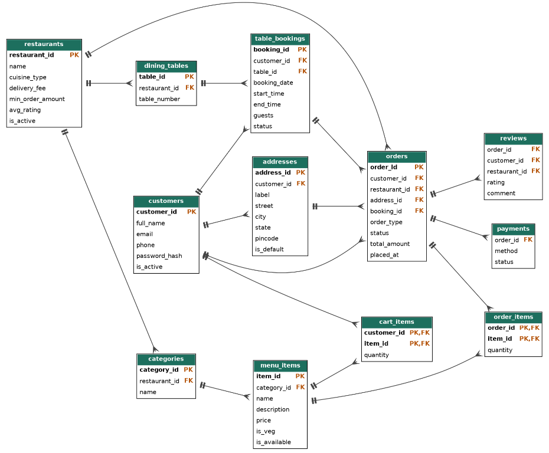
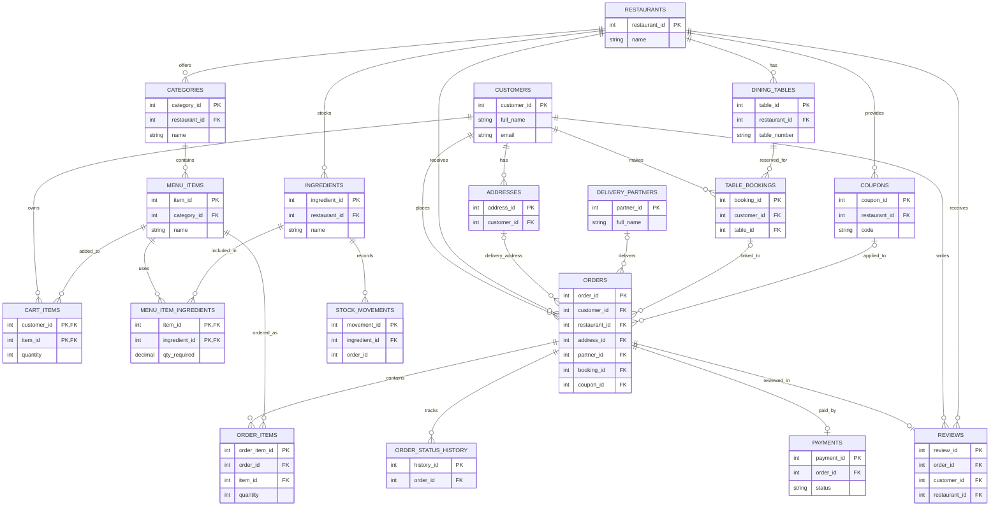

<div align="center">

# Restaurant Food Ordering

**A PHP and MySQL web app for restaurant menus, online orders, and table bookings.**

[](https://www.php.net/)
[](https://www.mysql.com/)
[](https://github.com/chin17-Abd/restaurant-food-ordering)

</div>

---

## Overview

Restaurant Food Ordering is a server-rendered application for browsing restaurant menus, placing orders, and reserving tables. Customers can manage their orders and bookings, while administrators can manage menu availability and order progress.

> **Project status:** The source code and database schema are included. No seed data is provided, so add appropriate restaurant and menu data before using the app.

## Features

| Area | Capabilities |
| --- | --- |
| Customer accounts | Registration, password-based login, and email OTP verification |
| Restaurant menu | Browse active restaurants and available menu items |
| Cart and checkout | Manage cart items and place delivery, pickup, or dine-in orders |
| Orders | View order history, cancel eligible orders, and review delivered orders |
| Table bookings | Create and cancel bookings; select a booking for dine-in checkout |
| Admin dashboard | View orders and reports, update order status, and manage menu availability |

## Technology

- **Application:** PHP
- **Database:** MySQL or MariaDB, accessed with PHP `mysqli`
- **Local environment:** XAMPP (Apache and MySQL)
- **Interface:** HTML and CSS

## Project structure

```text
.
├── admin/
│   └── index.php     # Admin dashboard
├── database/
│   └── food_ordering.sql # Food-ordering database structure
├── bookings.php      # Table booking and booking history
├── cart.php          # Cart and checkout
├── common.php        # Shared layout, session, and helper functions
├── db.php            # MySQL connection
├── index.php         # Restaurant and menu browsing
├── login.php         # Customer login
├── otp.php           # OTP verification
├── orders.php        # Order history and reviews
├── register.php      # Customer registration
└── style.css         # Application styles
```

## Run locally

### Requirements

- PHP with the `mysqli` extension
- MySQL or MariaDB
- A local PHP web server, such as XAMPP

### Setup

1. Clone or copy this repository into your web server's document root (for XAMPP, usually `htdocs`).
2. Start Apache and MySQL.
3. Create a MySQL database named `food_ordering`.
4. Import [`database/food_ordering.sql`](./database/food_ordering.sql) using phpMyAdmin's **Import** tab.
5. Review `db.php` and configure the connection for your local MySQL account.
6. Open `http://localhost/restaurant/` in your browser. Change `restaurant` in the URL if you chose another folder name.

### Database requirement

The SQL file contains only the `food_ordering` database structure (tables, triggers, and views). It excludes rows and other databases from the phpMyAdmin server export. No sample restaurant or menu data is included, so add appropriate data before using the app.

### Entity relationship diagram

The project ER diagram is shown below. The full table and foreign-key relationships from [`database/food_ordering.sql`](./database/food_ordering.sql) are also documented in the Mermaid diagram that follows.



The Mermaid diagram below includes the schema's foreign-key relationships. `stock_movements.order_id` is not shown as a relationship because the SQL schema does not define a foreign key for it.



> **Stored procedures:** The export does not include stored procedures. Several app actions call procedures such as `sp_add_to_cart`, `sp_place_order`, and `sp_book_table`; those actions need the matching procedures added to the database before they will work. The downloaded server-wide export is not included; it contained unrelated databases and phpMyAdmin tables.

## Development and security notes

- OTP display is enabled for local demo use. Do not use demo OTP behavior in a production deployment.
- The admin page currently contains a hard-coded password. Replace it with a secure configuration before running the application, and never reuse a real account password.
- The default database connection in `db.php` uses local development settings. Do not deploy with insecure or default database credentials.
- This project has not been documented as production-ready. Before deployment, review authentication, authorization, validation, error handling, email delivery, and HTTPS configuration.
- Never commit real passwords, API keys, private keys, or customer data.

## Contributing

Bug reports and focused improvements are welcome. Please open an [issue](https://github.com/chin17-Abd/restaurant-food-ordering/issues) to discuss a significant change before submitting it.

## License

No license has been added to this repository yet. Until a license is provided, reuse and redistribution are not granted by the project.
